# github-cool-readme

Animated SVG cards for a GitHub profile README, generated by a scheduled GitHub Action and published on a `cards` branch of your profile repo, so they don't add to its history:

- **Summary**: commits, pull requests created and reviewed, issues and stars, for the last 12 months and all time; share of active days.
- **Languages**: each repo's language mix weighted by your commits there.
- **Weekly rhythm**: your contributions per weekday over the last 12 months.
- **Notable contributions**: your merged (and open) pull requests to other people's public projects, by stars.

Two more you can turn on (setup lists them, off):

- **Streaks** (`streaks`): your current and longest streak, active days, and your best day and month, from your whole contribution history.
- **About** (`about`): a headline, a few lines and a few facts of your own, from the settings. A card can't hold working links, so put those under it.

Private and organization work is counted (it can be turned off). Only totals appear on the cards; private repo names never do. The cards come in three styles.

### Quick Setup
```bash
bash <(curl -fsSL https://raw.githubusercontent.com/pedrocatalao/github-cool-readme/v1/setup.sh)
```

For details see [Setup](#setup).

## Classic cards

GitHub's own look: its fonts, colours and icons on a transparent background, following the viewer's light or dark theme. The default.

```yaml
look:
  style: classic
cards:
  summary:
    ring: github        # the GitHub logo in the ring; leave out for the percentage
```

With `color: amber`, `green`, `purple`, `cyan`, `red` or `blue` under `look`, the ring, the weekly bars and the streaks highlight take that colour.

<p align="center">
<picture>
  <source media="(prefers-color-scheme: dark)" srcset="examples/cards/summary-dark.svg">
  
</picture>
<picture>
  <source media="(prefers-color-scheme: dark)" srcset="examples/cards/languages-dark.svg">
  
</picture>
</p>
<p align="center">
<picture>
  <source media="(prefers-color-scheme: dark)" srcset="examples/cards/contributions-dark.svg">
  
</picture>
<picture>
  <source media="(prefers-color-scheme: dark)" srcset="examples/cards/weekly-dark.svg">
  
</picture>
</p>

## Dot matrix and OLED cards

The same numbers as pinball-style displays: big readable text in a dot font, one item at a time with pinball transitions. `style: dotmatrix` draws them in round LEDs over a faint grid of unlit ones; `style: oled` in square pixels. Their colour is GitHub's (the default), amber, green, purple, cyan, red or blue, on a transparent background or a colour of your own. The examples also have the GitHub logo in the summary's ring (`ring: github`).

**Amber**, on a dark panel: the orange of a plasma display.

```yaml
look:
  style: dotmatrix
  color: amber
  background: 0d0b07    # a colour of your own, without #; leave out for none
```

<p align="center">
</p>
<p align="center">
</p>

**GitHub**: GitHub's own text and blue, on a transparent background, following the viewer's light or dark theme.

```yaml
look:
  style: dotmatrix
```

<p align="center">
<picture>
  <source media="(prefers-color-scheme: dark)" srcset="examples/dotmatrix-cards/github/summary-dark.svg">
  
</picture>
<picture>
  <source media="(prefers-color-scheme: dark)" srcset="examples/dotmatrix-cards/github/languages-dark.svg">
  
</picture>
</p>

**Green**, on a transparent background: bright on a dark page, darker on a light one.

```yaml
look:
  style: dotmatrix
  color: green
```

<p align="center">
<picture>
  <source media="(prefers-color-scheme: dark)" srcset="examples/dotmatrix-cards/green/summary-dark.svg">
  
</picture>
<picture>
  <source media="(prefers-color-scheme: dark)" srcset="examples/dotmatrix-cards/green/languages-dark.svg">
  
</picture>
</p>

**OLED**: square pixels, in any colour.

```yaml
look:
  style: oled
  color: amber
  background: 0d0b07
```

<p align="center">
</p>

## Where the numbers come from

- Commits, pull requests, issues, reviews: GitHub's contributions API, with the same rules as the contribution graph on your profile. Without the token's `read:user` scope it hides private work.
- Notable contributions: your list of pull requests.
- Stars: the current total on your repos (forks left out), and how many of those were given in the last 12 months.
- Active days, weekly rhythm, streaks: your contribution calendar. The `count` settings can't filter it.

Repos you can no longer access (e.g. a former employer's) can't be counted.

## Setup

```bash
bash <(curl -fsSL https://raw.githubusercontent.com/pedrocatalao/github-cool-readme/v1/setup.sh)
```

The command above needs [gh](https://cli.github.com) logged in. It asks before each change (`--dry-run` changes nothing), and does the steps below. Run it again any time to change which cards are shown and in what order, the style, colour, background or what's counted; your other settings stay as they are. Settings from before v1.5 are moved to the new layout.

To turn the cards off, run it and turn every card off. They're taken out of your README, but the marked block stays, so they come back in the same place. The workflow loses its schedule but can still be started by hand. Your token, settings and the `cards` branch are kept. To bring them back, run it again and turn a card on.

### By hand

1. Create a classic personal access token with the `repo`, `read:org` and `read:user` scopes. If an organization uses SAML SSO, authorize the token for it.
2. In your profile repo, add it as the secret `CARDS_TOKEN`, copy [examples/profile-workflow.yml](examples/profile-workflow.yml) to `.github/workflows/cool-readme.yml`, and optionally add a `cool-readme.yml` (see below).
3. Run the workflow once (it creates the `cards` branch), then put the cards in your README, with your login for `you`:

```html
<picture>
  <source media="(prefers-color-scheme: dark)" srcset="https://raw.githubusercontent.com/you/you/cards/summary-dark.svg">
  
</picture>
```

Same for `contributions`, `languages`, `weekly`, `streaks` and `about`. Show every card at `width="400"`: two fit a row, and on a narrow screen they stack. Every card then shows as 400 by 195: classic ones are that size, dot matrix and OLED ones are 450 by 219, scaled to fit.

## Settings

`cool-readme.yml`, all optional. Defaults:

```yaml
user: null                # defaults to the token's owner

show: [summary, languages, contributions, weekly]   # the cards, in README order; [] for none
                          # also: streaks, about

count:
  private: true           # private repos in the numbers
  orgs: true              # repos of organizations you belong to

look:
  style: classic          # classic, oled (square pixels) or dotmatrix (round LEDs)
  color: github           # GitHub's blue and greens; amber, green, purple, cyan, red or blue: what highlights
  animations: true        # false: still cards
  background: none        # the page shows through (amber and green go darker on light pages), or a colour
                          # without #, like 030506: the same for every viewer, the text in shades that suit it
  border: false           # classic only: a thin outline, like GitHub's boxes

cards:
  summary:
    title: null           # small, on the header line
    ring: percent         # or github: the GitHub logo in the ring, the percentage in the title
  languages:
    title: Most used languages   # null hides it
    count: 6
    hide: []              # language names; their share is dropped
    repos: {}             # weight per repo, "repo" for your own, "owner/repo" otherwise; 0 leaves it out
    other: true           # fold the rest into "Other"; false: the shown ones share 100%
  contributions:
    title: Notable contributions
    count: 6              # 3 in view at a time; the rest scroll past in a loop
    open: true            # open pull requests count too, not only merged ones
    pin: []               # shown first; pull requests closed without merging never count
    hide: []
  weekly:
    title: Weekly rhythm
  streaks:
    title: Streaks
  about:
    title: About
    headline: null        # shown large
    lines: []             # a line each; they're not wrapped, and more than fit scroll past
    facts: {}             # label: text, a line each under the lines
```

A card that's not in `show` keeps its settings under `cards`, for when it's back. Unknown settings are an error, so typos don't go unnoticed.

Settings from before v1.5, with everything at the top (`cards: [...]`, `style`, `include`, `theme`...), still work, and look the same: running setup again moves them to this layout.

## Local development

Needs Node 22.18 or newer (TypeScript runs directly, no build step).

```bash
GITHUB_TOKEN=$(gh auth token) npm run dev   # fetch, render to out/, write out/preview.html
npm run dev:offline                          # re-render from the saved data, no API calls
npm run preview:oled                         # every dot matrix and OLED look side by side, in out/display/
npm test
```

`npm run dev` saves the raw data to `.cache/snapshot.json`. It names private repositories, so keep it out of anything public (it is gitignored).

## License

MIT
